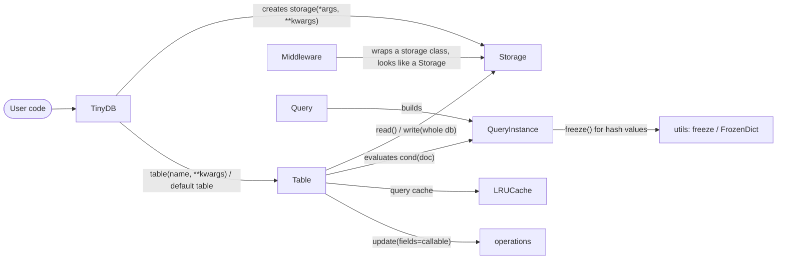

# TinyDB Architecture

TinyDB is a small, pure-Python, document-oriented database. A database is one Python `dict` of tables; each table is a
`dict` of documents keyed by document ID. The whole dict is persisted by a pluggable *storage*, optionally wrapped in
*middlewares*. Reads and writes always move the complete database between the storage and the in-memory table logic.

## 1. Components

| # | Component | Module | Responsibility |
|---|---|---|---|
| 1 | `TinyDB` | `tinydb/database.py` | Entry point. Creates the storage instance, creates and remembers `Table` objects by name, and forwards unknown attributes to the default table (`_default`). |
| 2 | `Table`, `Document` | `tinydb/table.py` | All document operations (insert, search, get, update, upsert, remove, truncate, count). Owns document-ID allocation and a per-table query-result cache. `Document` is a `dict` that also carries `doc_id`. |
| 3 | `Query`, `QueryInstance`, `where` | `tinydb/queries.py` | Query language. `Query` builds a field path (`Query().a.b`); comparison methods return a `QueryInstance`, a callable `document -> bool` that also carries a stable hash used as the cache key. Instances combine with `&`, `\|`, `~`. |
| 4 | `Storage`, `JSONStorage`, `MemoryStorage` | `tinydb/storages.py` | Persistence. `Storage` is an abstract base class with `read()`, `write(data)` and an optional `close()`. `JSONStorage` keeps an open file handle; `MemoryStorage` keeps the dict in memory. |
| 5 | `Middleware`, `CachingMiddleware` | `tinydb/middlewares.py` | Wrappers around a storage class that look like a storage to `TinyDB`. `CachingMiddleware` keeps the last database state in memory and writes to the wrapped storage every `WRITE_CACHE_SIZE` writes, on `flush()` and on `close()`. |
| 6 | Utilities | `tinydb/utils.py` | `LRUCache` (the query cache), `freeze`/`FrozenDict` (turn dicts, lists and sets into hashable values for query hashes) and `with_typehint` (typing helper for `TinyDB` forwarding to `Table`). |
| 7 | Update operations | `tinydb/operations.py` | Small factories (`delete`, `add`, `subtract`, `set`, `increment`, `decrement`) that return callables mutating a document; passed to `Table.update`. |

The package root `tinydb/__init__.py` re-exports `TinyDB`, `Storage`, `JSONStorage`, `Query` and `where`.

**Typical call flow.** `db.search(q)` → `TinyDB.__getattr__` → default `Table.search(q)` → look up `q` in the table's
`LRUCache`; on a miss, `Storage.read()` returns the whole database, the table's documents are filtered with `q(doc)`,
and the result is stored in the cache if `q` is cacheable. `db.insert(doc)` → `Table.insert` → `Table._update_table`
→ `Storage.read()`, modify the table dict, `Storage.write(whole db)`, then clear the table's query cache.

## 2. Architecture Decision Records

### ADR-1: Storages read and write the complete database as one dict

- **Status:** Verified. The `Table._update_table` docstring states that the storage interface only allows reading and
  writing the complete database (`tinydb/table.py:808-812`). The v4 upgrade notes (removed `docs/upgrade.rst`) record
  that empty storages return `None`.
- **Context:** TinyDB targets small applications and wants storages to be trivial to write (JSON file, memory, YAML,
  third-party formats).
- **Decision:** A storage exposes only `read() -> dict | None` and `write(dict)` for the whole database (`None` means
  "empty / uninitialised"). All partial updates happen in memory inside `Table._update_table`: read everything,
  modify one table's dict, write everything back. Document IDs are stored as strings and converted to
  `Table.document_id_class` (default `int`) when read for an update.
- **Alternatives considered (inferred):** a per-document or per-table storage API (more efficient, but every storage
  would need indexing and partial-write logic); an append-only log (fast writes, but needs compaction).
- **Consequences:** Writing a new storage needs about 20 lines. Every write costs O(size of the whole database), which
  is acceptable for the target scale but makes TinyDB unsuitable for large data. Because storages only see whole
  snapshots, cross-cutting behaviour (caching, filtering) can be added by wrapping a storage (ADR-2).

### ADR-2: Configuration by composition: storage classes, middleware wrappers and argument forwarding

- **Status:** Verified. The `TinyDB` docstring says all arguments except `storage` are passed to the storage class
  (`tinydb/database.py:32-35`), implemented at `tinydb/database.py:92-95`. The `Middleware.__call__` docstring explains
  the wrapping mechanism (`tinydb/middlewares.py:25-65`). Commit `fa2b76c` ("Create infrastructure for custom table
  classes", 2014) introduced customisable table classes.
- **Context:** Users need to choose where data lives and to add behaviour such as caching without TinyDB knowing
  about every combination.
- **Decision:** `TinyDB(*args, storage=StorageClass, **kwargs)` instantiates `StorageClass(*args, **kwargs)`; it
  consumes only `storage` itself. A middleware is an *instance* that wraps a storage *class*
  (`CachingMiddleware(JSONStorage)`); when `TinyDB` "instantiates" it, `Middleware.__call__` creates the real storage
  with the forwarded arguments and returns the middleware, which then behaves like a storage and forwards unknown
  attributes to it. Tables are created by `TinyDB.table(name, **kwargs)` as `table_class(storage, name, **kwargs)`.
  Behaviour is customised through class attributes (`TinyDB.table_class`, `default_table_name`,
  `default_storage_class`; `Table.document_class`, `document_id_class`, `query_cache_class`,
  `default_query_cache_capacity`) instead of constructor flags.
- **Alternatives considered (inferred):** a configuration object or many `TinyDB` constructor flags (central, but every
  new storage option would need changes in `TinyDB`); subclassing storages to add caching (combinatorial explosion).
- **Consequences:** Storages and middlewares compose freely and stay independent of `TinyDB`. The cost is that the
  argument list of `TinyDB(...)` belongs to the storage: any keyword `TinyDB` does not consume reaches the storage
  constructor (`MemoryStorage` accepts none).

### ADR-3: Per-table query-result cache keyed by query identity, invalidated on every write

- **Status:** Verified. `Table` documents the query cache and its invalidation (`tinydb/table.py:41-50`), and
  `QueryInstance` documents the need for a stable hash (`tinydb/queries.py:71-73`). Commit `f200118` ("feat: support
  `map` query operation", #445) and commit `1fa99fb` ("fix: make query callables work again") introduced and adjusted
  non-cacheable queries; commit `8d3f0c7` (#617) documents that search results share objects with the cache.
- **Context:** Applications often repeat the same query, and every uncached search reads and scans the whole
  database (ADR-1).
- **Decision:** Each `Table` keeps an `LRUCache` (capacity `cache_size`, default `default_query_cache_capacity = 10`)
  mapping a query object to its result list. A query's identity is its hash value: a tuple built from the operation
  name, the field path and the frozen arguments; `&`/`\|` use a `frozenset` so the operands' order does not matter.
  `Table.search` consults the cache first and stores results only for cacheable queries. Queries that cannot be
  given a reliable identity (a `map` with an arbitrary, possibly mutable callable, or arguments that cannot be hashed
  even after `freeze`) get the hash value `None` and are never cached. Every write
  through `_update_table` clears the table's cache.
- **Alternatives considered (inferred):** no cache (simpler, slower for repeated queries); caching by query string
  representation (fragile); invalidating only affected entries (complex for the expected scale).
- **Consequences:** Repeated searches are cheap. Correctness depends on two invariants: two queries that can select
  different documents must never have equal hash values, and every write must clear the cache. Changes made to the
  storage outside the table are not seen until `clear_cache()`. Cached result documents are shared objects and must
  be treated as read-only.

## 3. Constraints

| # | Rule a change must not break | Where it can be seen |
|---|---|---|
| C1 | New storages subclass `Storage` and implement `read()` (return `None` when empty) and `write(data)` for the whole database; `close()` is optional. | `tinydb/storages.py:36-76` |
| C2 | `TinyDB` passes every positional and keyword argument except `storage` unchanged to the storage constructor; middlewares receive the same arguments through `Middleware.__call__`. | `tinydb/database.py:92-95`, `tinydb/middlewares.py:63` |
| C3 | All table modifications go through `Table._update_table`, which writes the whole database and then clears the table's query cache; table methods must not write to the storage directly. | `tinydb/table.py:804-854` |
| C4 | A `QueryInstance`'s hash value is its cache identity: equal queries must have equal hash values and queries that can select different documents must not. New query tests build their hash from the operation name, the path and `freeze()`-d arguments, resolve the path through `Query._generate_test`, and use `None` as hash when the result is not deterministic. | `tinydb/queries.py:76-112`, `tinydb/queries.py:218-252`, `tinydb/utils.py:150-169` |
| C5 | Dependency direction is one-way: inside the package, `queries.py` imports only `utils`; `table.py` imports `queries`, `storages` and `utils` but never `database`; `database.py` sits on top. TinyDB has no third-party runtime dependencies. | import lines in `tinydb/queries.py:23`, `tinydb/table.py:15-17`, `tinydb/database.py:7-10`; `pyproject.toml` (no `dependencies`) |
