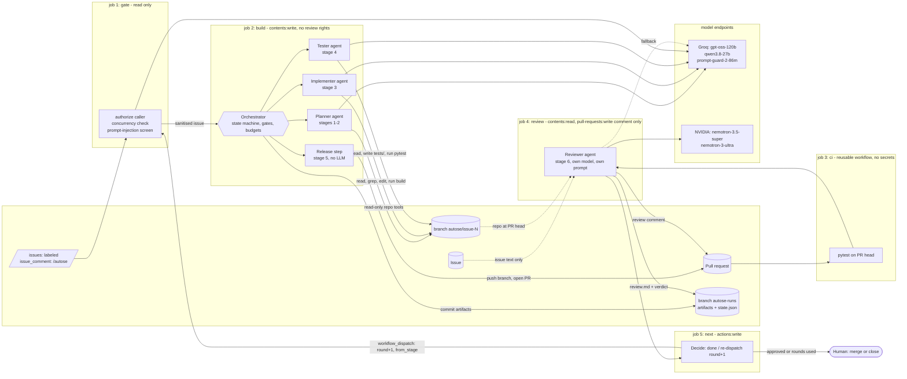

# Component view

Status: design, committed before any agent code. Updated if a decision is superseded.

Three LLM agents and one deterministic orchestrator. The orchestrator is ordinary Python; it runs the gates, owns the state machine and decides every back-edge. Release (stage 5) has no agent: it is code.

## Who can see and do what

| Component | Reads | Writes | Model |
|---|---|---|---|
| Gate | event payload, collaborator permission | nothing | prompt-guard-2-86m (classifier only) |
| Orchestrator | every artifact, state.json, gate results | artifacts and state on `autose-runs`, branch `autose/issue-N` | none |
| Planner | sanitised issue, `ARCHITECTURE.md`, repo (read-only tools) | `spec.md`, `design.md` | gpt-oss-120b |
| Implementer | `spec.md`, `design.md`, repo | code on branch `autose/issue-N` | gpt-oss-120b |
| Tester | `spec.md`, file list from `design.md`, repo | files under `tests/`, `test_report.md` | gpt-oss-120b |
| Release | all artifacts | push branch, open PR, `pr.md` | none |
| Reviewer | issue text, `diff.patch`, repo at PR head | `review.md`, a PR review comment | nemotron-3.5-super, then nemotron-3-ultra, then qwen3.8-27b |

The reviewer never receives the planner's, implementer's or tester's messages, nor `spec.md`, `design.md` or `test_report.md`. See ADR-003 and ADR-008.
