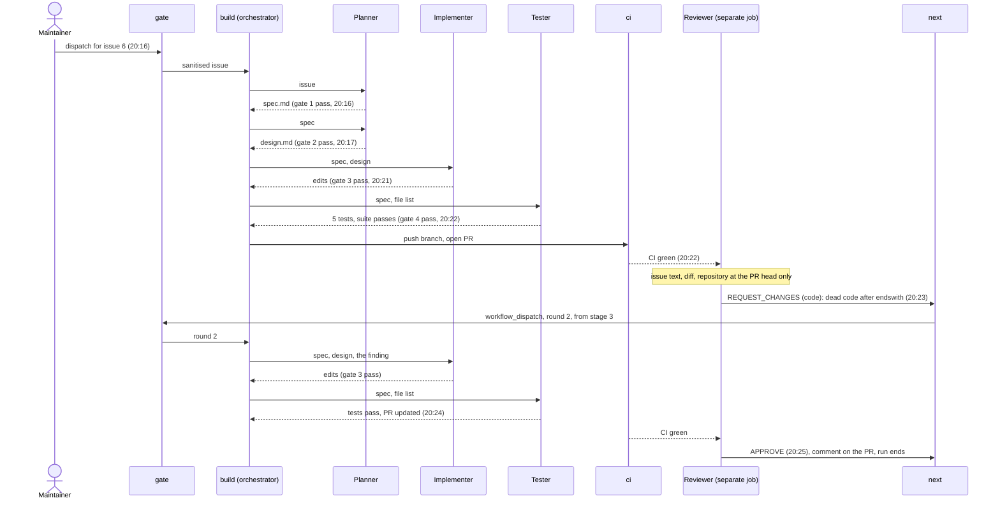

# Sequence view

A real run, from the trigger to the review and the next round: issue #6 (`startswith` / `endswith`), Actions runs
[44389251586](https://github.com/Ekansh0301/tinydb/actions/runs/44389251586) (round 1) and
[44390507790](https://github.com/Ekansh0301/tinydb/actions/runs/44390507790) (round 2). Times are from `stages.jsonl` and the job records.
The planned sequence that was committed before any agent code is in the git history of this file.

## Agents, artifacts and checks for each stage
See `stage_map.md`.
