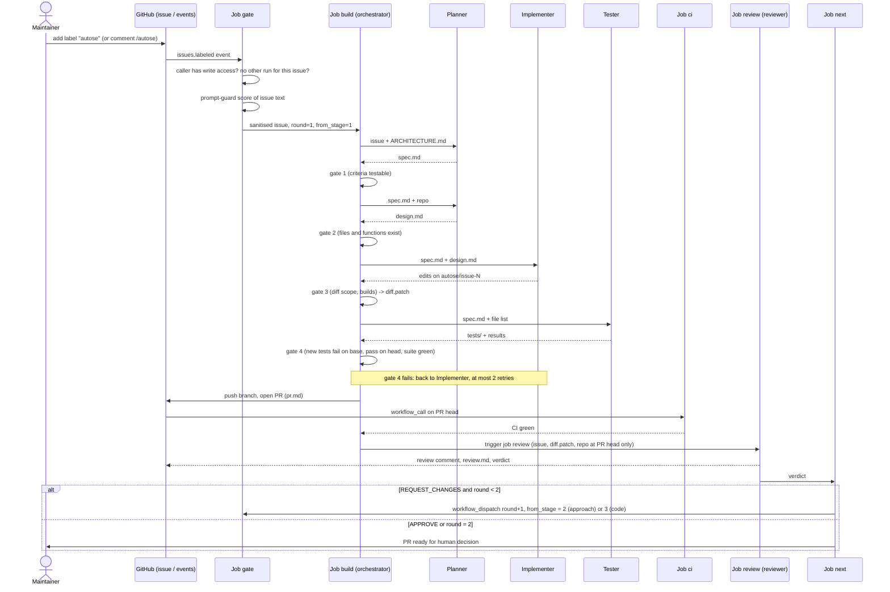

# Sequence view

Status: PLANNED. This is the intended message flow, committed before any agent code. It is replaced by a sequence taken from a real run (with Actions run links) once a run exists; the planned version stays in git history.

